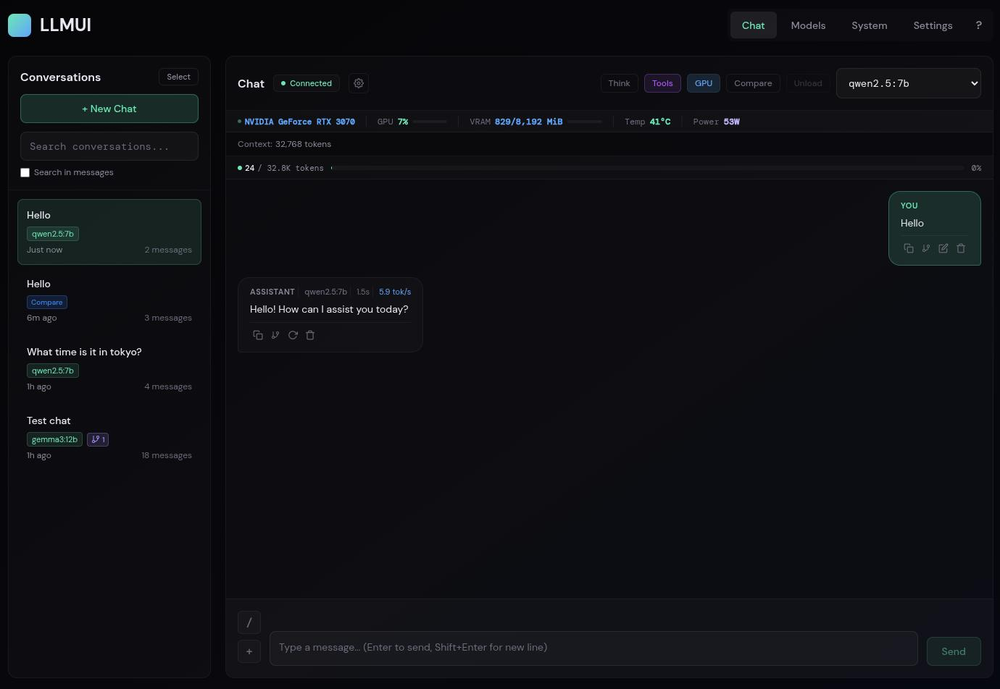

# LLMUI

> **Beta Software**: This project is under active development. Works on Linux, Windows (sort of), and macOS.

A web interface for chatting with local LLMs served by an OpenAI-compatible server (llama.cpp `llama-server`, vLLM, LM Studio, ...).



## What it does

- **Chat** with any model your OpenAI-compatible `/v1` server provides
- **Compare models** - send the same prompt to 2-4 models and see responses side-by-side
- **Tool calling** - web search, URL fetch, calculator, current time, sandboxed file reads, and a Blender bridge for models that support function calling
- **Per-chat settings** - override model, system prompt, temperature, or max tokens for a single conversation without touching your defaults
- **GPU monitoring** - see your VRAM usage, temperature, utilization in real-time (NVIDIA only)
- **Conversation history** - stored in SQLite at `~/.llmui/` with full-text search
- **Conversation branching** - edit any message to create alternate branches, navigate between them
- **Setup wizard** - walks first-time users through verifying GPU stats
- **Terminal UI** - a full-screen TUI (`npm run tui`) to browse, resume, and continue your chats from the terminal, sharing the same history as the web UI
- **Light and dark themes**
- Configurable system prompts, temperature, max tokens

## Requirements

- [Node.js](https://nodejs.org/) (v18 or higher)
- An OpenAI-compatible model server exposing `/v1/models` and `/v1/chat/completions` (e.g. llama.cpp `llama-server`)

For GPU stats you'll need an NVIDIA GPU with drivers installed. If you don't have one, the app still works fine - you just won't see the GPU panel.

## Installation

### Linux

1. Install Node.js (if not already installed):
   ```bash
   # Ubuntu/Debian
   curl -fsSL https://deb.nodesource.com/setup_20.x | sudo -E bash -
   sudo apt install -y nodejs

   # Fedora
   sudo dnf install nodejs

   # Arch
   sudo pacman -S nodejs npm
   ```

2. Clone and install:
   ```bash
   git clone <repo-url>
   cd llmui
   npm install
   ```

### Windows

1. Install Node.js (v18 or higher):
   - Download from [nodejs.org](https://nodejs.org/) and run the installer
   - Or use winget: `winget install OpenJS.NodeJS`

2. Clone and install (in PowerShell):
   ```powershell
   git clone <repo-url>
   cd llmui
   npm install
   ```

   Or use the install script which checks prerequisites:
   ```powershell
   .\scripts\install.ps1
   ```

## Running

Point LLMUI at your model server with `OPENAI_BASE_URL` (must include the `/v1` suffix), then start the UI:

```bash
OPENAI_BASE_URL=http://<host>:<port>/v1 npm run dev
```

```powershell
# Windows (PowerShell)
$env:OPENAI_BASE_URL="http://<host>:<port>/v1"
npm run dev
```

### Compute machines

LLMUI knows two machines, defined in `server/backends.js`. Each runs a llama.cpp router, an sd-server and the sd-fetch helper (`deploy/sd-fetch`).

| Machine | Router key | sd config | sd-fetch token |
| --- | --- | --- | --- |
| Jellyfin (default) | `LLAMA_API_KEY` in `~/.llmui/llama.env` | `~/.llmui/sd_config.json` | `~/.llmui/sd-fetch.token` |
| Workstation | `~/.llmui/workstation-llama.key` | `~/.llmui/sd_config.workstation.json` | `~/.llmui/workstation-fetch.token` |

Chat and images run on Jellyfin unless you select the Workstation on the System page. The choice is saved in `~/.llmui/machine.json`. Each machine is checked every 10 s. While the selected Workstation's router or sd-server is unreachable, those requests go to Jellyfin and the app shows a notice. Switching machines never loads or unloads a model. An image job still unloads chat models, but only on the machine it runs on. To override a machine's name or URLs, use `~/.llmui/machines.json`, e.g. `{"workstation": {"llamaUrl": "http://host:8081/v1"}}`. `OPENAI_BASE_URL` still sets Jellyfin's router.

Or use the start script which checks port availability:
```powershell
.\scripts\start.ps1
```

Open http://localhost:3000 in your browser. This runs both the storage server (port 3001) and the Vite dev server for the frontend (port 3000). Both servers listen on `127.0.0.1` only (set `HOST` to change the storage server's bind address).

**Production / always-on:** build the frontend once with `npm run build`, then run `npm start` (or the `deploy/llmui.service` systemd unit). Express serves the built app and the API together on `127.0.0.1:3001`; no Vite process is involved. Rebuild after frontend changes and restart. For access from other machines, publish it on your tailnet with `tailscale serve --bg --https=<port> http://127.0.0.1:3001`.

The browser never talks to the model server directly: all model traffic goes through the authenticated Express server (`/openai/v1/*` passthrough, and `/api/chat-with-tools` for the server-side tool loop).

Conversations from older versions that used Ollama models still open, but read-only (their model isn't served anymore) — start a new chat to continue.

On first launch a setup wizard appears. It confirms GPU stats are reachable. You can rerun it any time by clearing the `setup_completed` setting in the database, or just adjust everything from the Settings tab afterwards.

### Windows Troubleshooting

**Node.js version requirement:** Node.js v20 LTS is required. Node v21+ will fail to compile `better-sqlite3` due to missing prebuilt binaries and node-gyp compatibility issues.

Use [nvm-windows](https://github.com/coreybutler/nvm-windows) to manage Node versions:
1. Download and run `nvm-setup.exe` as Administrator
2. Open **Command Prompt** (not PowerShell) as Administrator
3. Run:
   ```cmd
   nvm install 20
   nvm use 20
   node --version
   ```

**Visual Studio Build Tools:** `better-sqlite3` requires native compilation. Install [Visual Studio Build Tools 2022](https://visualstudio.microsoft.com/visual-cpp-build-tools/) and select the **"Desktop development with C++"** workload.

**Python:** Also required by node-gyp. Install from [python.org](https://www.python.org/downloads/) and check **"Add Python to PATH"** during installation.

Once all prerequisites are installed:
```cmd
cd llmui
npm install
npm run dev
```

> ⚠️ **All commands must be run in Command Prompt, not PowerShell.**

**Port already in use:**
- Another app is using port 3000 or 3001
- Close other development servers or apps
- Check with: `netstat -ano | findstr :3000`

**No models listed:**
- Make sure your model server is running and `OPENAI_BASE_URL` points at it (including `/v1`)
- Try `curl $OPENAI_BASE_URL/models` from the machine running LLMUI

## Configuration

Most settings can be changed in the Settings tab:

- **System Prompt** - gets sent at the start of every conversation
- **Temperature** - lower = more focused, higher = more creative
- **Max Tokens** - limit on response length
- **Theme** - light or dark
- **Tools** - enable or disable individual tools the model can call

Click the gear icon next to a conversation's title to override any of these for that conversation only — useful for trying a different model or system prompt without changing your defaults.

### Tools

When tool calling is enabled and the model supports it (most recent Llama, Qwen, Mistral, and similar tool-capable models), the assistant can invoke:

- **Web Search** - DuckDuckGo search (on by default)
- **Current Time** - returns the local date and time (on by default)
- **Fetch URL** - downloads page content; blocks private/internal IPs to prevent SSRF
- **Calculator** - safe arithmetic expression evaluator
- **File Read** - reads files from a sandboxed `~/.llmui/tool_sandbox/` directory only
- **Blender Execute** - sends Python to a running Blender instance via the bundled `blender_addon/llmui_bridge.py` (install it from Blender's add-on preferences first)

Tool calls and their results render inline in the conversation as expandable cards.

### Models

The Models tab lists the models your `/v1` server provides. Loading and unloading models is done on the model server itself.

### Compare Mode

Compare mode lets you send the same prompt to 2-4 models simultaneously and view their responses side-by-side. Click the "Compare" toggle in the chat header to enable it.

For real parallelism, configure your model server to serve several models/requests concurrently (e.g. llama.cpp `--parallel`). The UI will show a warning if your selected models' combined size exceeds your GPU capacity.

### Conversation Branching

Edit any message in a conversation to create an alternate branch. The original conversation is preserved, and you can navigate between branches using the arrow controls that appear when a message has multiple versions.

This is useful for:
- Trying different phrasings of a prompt to see how the model responds
- Exploring alternative directions in a conversation without losing the original
- A/B testing different approaches to a problem

Branches are stored as part of the conversation history and persist across sessions.

## Terminal UI (TUI)

Prefer the terminal? Run a full-screen TUI against the same server and history:

```bash
npm run tui
```

It reads the auth token from `~/.llmui/token` and talks to the LLMUI server on port 3001, so conversations you start here show up in the web UI and vice versa.

- The left pane lists your conversations (newest first) — `↑`/`↓` to move, `Enter` to open and resume one
- Manage chats from the list: `n` new, `r` rename, `a` archive, `A` toggle the archived view, `d` delete, `m` pick a model
- `Tab` switches focus between the list and the message input, `t` toggles tool calling, `q` quits
- Responses stream live with markdown rendering (headings, lists, **bold**, code blocks) and inline tool-call cards
- Both sides of every exchange are saved to the shared SQLite database

Flags: `--model <name>` preselects a model, `--tools` starts with tool calling on, and `--server <url>` (or the `LLMUI_SERVER` env var) points at a non-default server.

```bash
npm run tui -- --model qwen2.5-coder-7b --tools
```

The server must be running first (`npm run server`, or `npm run dev`). The TUI is built with [Ink](https://github.com/vadimdemedes/ink) and run via `tsx`.

## Data storage

All data is stored locally in `~/.llmui/`:

- **Linux/macOS**: `/home/<user>/.llmui/`
- **Windows**: `C:\Users\<user>\.llmui\`

- **Database**: `llmui.db` - SQLite database (WAL mode) containing conversations, messages, and settings
- **Auth token**: `token` - bearer token for API authentication
- **Backups**: `backups/` - database backups created via the API

### Migration from JSON

If you're upgrading from a previous version that used JSON files, the server automatically migrates your data to SQLite on first startup. Your original JSON files are preserved in `~/.llmui/legacy_backup_<timestamp>/`.

To preview what will be migrated without making changes:
```bash
node server/index.js --dry-run
```

This command works the same on Windows (PowerShell or Command Prompt).

### Full-text search

The database includes FTS5 full-text search across all messages. Search endpoint:
```
GET /api/search?q=<query>&conversation_id=<optional>
```

### Backup

Create a database backup:
```bash
# Linux/macOS
curl -X POST -H "Authorization: Bearer $(cat ~/.llmui/token)" http://localhost:3001/api/backup
```

```powershell
# Windows (PowerShell)
$token = Get-Content "$env:USERPROFILE\.llmui\token"
curl -X POST -H "Authorization: Bearer $token" http://localhost:3001/api/backup
```

Backups are stored in `~/.llmui/backups/`.

## Keyboard shortcuts

Press `Ctrl+/` (or `Cmd+/` on Mac) to see all shortcuts.
